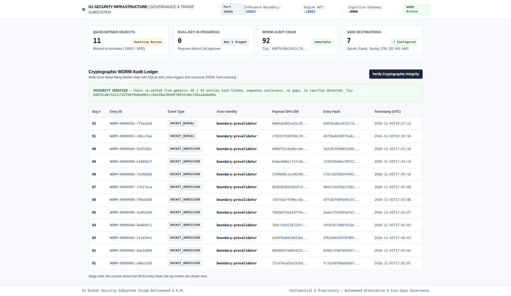
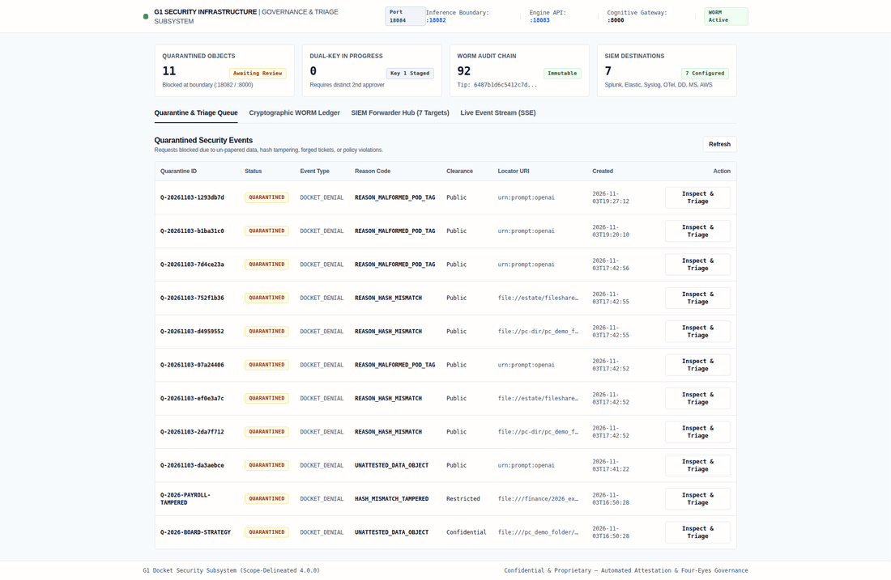
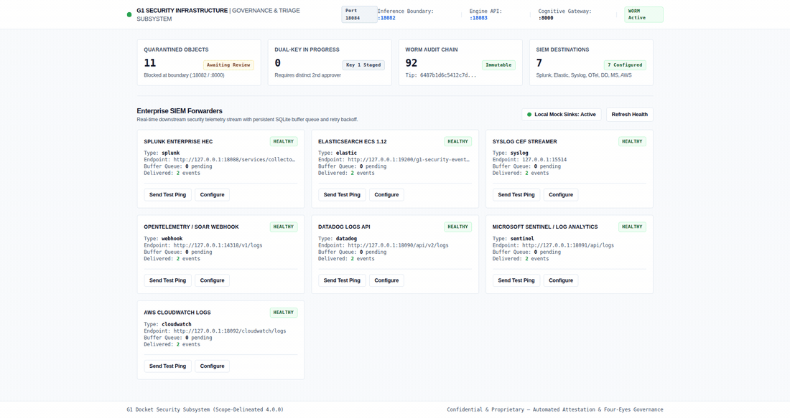

# Downstream Governance, Cryptographic WORM Ledger & SIEM Integration Subsystem

**G1 Docket & Combine Downstream Compliance Subsystem (`v4.0.0`)**  
*Document Version: 1.0.0 — G1163RT Security Labs*

---

## 1. Architectural Overview

The G1 Governance Subsystem provides the downstream compliance, tamper-evident audit logging, and human-in-the-loop (HITL) authorization layer for both **G1 Docket** (data attestation) and **G1 Combine** (runtime cognitive boundary defense).

```
   [ Enterprise Data Estate ]      [ LLM Inference Gateway ]
               │                               │
               ▼                               ▼
       G1 Docket Engine              G1 Prevalidator Proxy
       (:18083 / :18080)                    (:18082)
               │                               │
               │ (Attestations)                │ (Denials / Boundary Intercepts)
               └───────────────┬───────────────┘
                               │
                               ▼
        ┌────────────────────────────────────────────────┐
        │  HITL Governance & Compliance Hub (:18084)     │
        ├────────────────────────────────────────────────┤
        │  1. Cryptographic WORM Audit Ledger            │
        │     - SQLite WAL Write-Once Triggers           │
        │     - Merkle Hash-Chained JSONL Log            │
        │     - Genesis-to-Tip Integrity Verifier        │
        │                                                │
        │  2. Human-in-the-Loop (HITL) Dual-Key Engine   │
        │     - Four-Eyes Principle Enforcement          │
        │     - Ed25519 DSSE Emergency Ticket Minting    │
        │     - Automated Pipeline Replay (:18082)       │
        │                                                │
        │  3. Multi-Target SIEM Forwarder & Buffer Queue │
        │     - 7 Enterprise Cloud & On-Prem Destinations│
        │     - Zero Sensitive Data Leakage Sanitizer    │
        │     - Persistent SQLite Retry Buffer           │
        └──────────────────────┬─────────────────────────┘
                               │
            ┌──────────────────┴──────────────────┐
            ▼                                     ▼
   Enterprise SIEMs (Live / Mock)         SecOps HITL Dashboard
   - Splunk Enterprise HEC (:18088)       - Institutional Light Theme
   - Elasticsearch / OpenSearch (:19200)  - Quarantine Inspection Modal
   - Syslog CEF Streamer (:15514)         - Dual-Key Review Workflow
   - OpenTelemetry / SOAR (:14318)        - In-Place Config Editor
   - Datadog Logs API (:18090)
   - Microsoft Sentinel (:18091)
   - AWS CloudWatch Logs (:18092)
```

---

## 2. Component Specifications

### 2.1 Cryptographic WORM Audit Ledger (`governance/worm_ledger.py`)
- **Write-Once, Read-Many (WORM) Guarantee**: Employs SQLite WAL storage with database triggers that intercept and abort any `UPDATE` or `DELETE` statement at the database engine level with an `ABORT_WORM_IMMUTABLE` exception.
- **Merkle Hash Chaining**: Every record is sequentially indexed and linked to the cryptographic digest of the prior entry:
  $$\text{entry\_hash} = \text{SHA256}(\text{canonical\_json}(\text{record}) + \text{previous\_entry\_hash})$$
  - Genesis block links to: `0000000000000000000000000000000000000000000000000000000000000000` (64 zeroes).
- **Tamper Detection Utility**: `verify_ledger_integrity(path)` re-computes every cryptographic link from the genesis block to the tip, flagging deleted records, out-of-order sequences, or byte modifications.

<p align="center">
  
</p>

### 2.2 Human-in-the-Loop (HITL) Dual-Key Governance (`governance/dual_key.py`)
- **Quarantine Interception**: Un-papered files, forged DSSE envelopes, or Presidio/Combine PII violations arriving at the inference boundary are quarantined rather than silently discarded.
- **Four-Eyes Principle**:
  - **Key 1 (Requester)**: Operates with authorized identity `secops-analyst-1`, submitting a formal operational rationale for emergency exemption.
  - **Key 2 (Approver)**: Must be a **distinct, non-identical** authorized identity (`ciso-officer-2`). The system enforces $K_1 \neq K_2$.
- **Emergency DSSE Ticket Minting**: Approver signs a cryptographic DSSE envelope carrying an emergency classification ticket with short TTL.
- **Automated Replay**: Upon successful signature verification, the unquarantined clean payload is automatically re-submitted to the inference pipeline (`http://localhost:18082`).

<p align="center">
  
</p>

### 2.3 Multi-Target Enterprise SIEM Integration Engine (`governance/siem_forwarder.py`)
- **Zero Sensitive Data Leakage**: Document contents, sensitive tokens, or unredacted PII never touch downstream log sinks. The sanitizer extracts solely SHA-256 digests, file locators, classification tiers, Presidio rule IDs, and ticket identifiers.
- **Supported Formats & Transports**:
  1. **Splunk Enterprise HEC**: Batched JSON POST to `/services/collector/event` with Bearer auth headers.
  2. **Elasticsearch / OpenSearch**: Structured JSON mapping compliant with Elastic Common Schema (`ecs-1.12`).
  3. **Syslog CEF Streamer**: RFC 5424 Common Event Format over TCP with optional TLS encryption.
  4. **OpenTelemetry / SOAR Webhook**: Structured CloudEvents payload over HTTP POST.
  5. **Datadog Logs API**: Pre-mapped Datadog attributes (`service:g1-docket`, `status:warn|error`) via `/api/v2/logs`.
  6. **Microsoft Sentinel / Azure Log Analytics**: Formatted for custom table ingestion (`G1SecurityEvents_CL`).
  7. **AWS CloudWatch Logs**: Formatted for direct CloudWatch Logs PutLogEvents ingestion.
- **Resilience & Local Buffering**: If a downstream SIEM endpoint drops offline, events are buffered in a local SQLite queue (`siem_buffer.db`) and automatically drained upon reconnection.

<p align="center">
  
</p>

### 2.4 Compliance Evidence Exports (`/api/worm/export` & `/api/quarantine/export`)
For automated SOC 2 Type II, ISO 27001, and HIPAA audit reviews, the governance server provides turnkey JSON and CSV audit evidence exports:
- **`GET /api/worm/export?format=json|csv`**: Streams the entire linear SHA-256 Merkle-chained audit ledger with chronological sequence IDs, event types, payloads, and tip hashes.
- **`GET /api/quarantine/export?format=json|csv`**: Exports quarantined security incidents, including violation codes (`UNATTESTED`, `HASH_DRIFT`, `EGRESS_DENIED`), staged key justifications, and approver signatures.
- **UI Download Buttons**: Dedicated `Export CSV` and `Export JSON` buttons are integrated directly into the WORM Audit and Quarantine tables on the Governance Console (`:18084`).

### 2.5 Dynamic Enterprise Data Steward & Owner Resolution
To eliminate placeholder identities and route attestation requests to accountable business stewards, G1 Docket dynamically resolves accountable parties via:
1. **Live Data Catalog Synchronization**: Extracts dataset owners and subject-matter expert stewards in real time from OpenMetadata (`owners`, `experts`), Databricks Unity Catalog, Apache Iceberg, Snowflake, and Google BigQuery.
2. **Tier-Specific Routing Rules**:
   - `DOCKET_STEWARD_TIER_RESTRICTED`: Enterprise Security / Legal Data Stewards.
   - `DOCKET_STEWARD_TIER_CONFIDENTIAL`: Compliance & Risk Stewards.
   - `DOCKET_STEWARD_TIER_INTERNAL`: Business Domain Stewards.
   - `DOCKET_STEWARD_TIER_PUBLIC`: Open Data & Communications.
3. **Departmental & Domain Fallbacks**: `DOCKET_STEWARD_DOMAIN_<NAME>`, `DOCKET_DEFAULT_STEWARD`, and `DOCKET_DEFAULT_OWNER`.

### 2.6 Enterprise SSO / IdP Proxy Authentication & Production Mode
In enterprise deployments fronted by an API Gateway or Reverse Proxy (e.g., Cloudflare Access, AWS ALB, Azure App Gateway, NGINX / Envoy), the Governance Console automatically extracts authenticated operator identities from verified upstream headers:
- `X-Forwarded-Email`, `X-Auth-Request-Email`, `CF-Access-Authenticated-User-Email`
- `X-MS-Client-Principal-Name`, `X-Goog-Authenticated-User-Email`, `X-Forwarded-User`, `Remote-User`

When `DOCKET_ENVIRONMENT=production` (or legacy `DOCKET_DEMO_MODE=false`) is configured:
- Quick-fill demo analyst buttons are hidden in the Four-Eyes Dual-Key triage modal.
- Form inputs require verified enterprise operator emails matching your organization's domain.
- Mock identities (`demo-*`) are blocked with HTTP 403.
- The Four-Eyes principle strictly prevents self-approval: requester and approver must possess distinct, verified corporate credentials ($K_1 \neq K_2$).

For full documentation on institutional credentials, password overrides, role matrices, and SSO/OIDC integration, see **[Authentication & Access Control (RBAC) Guide](authentication-and-access-control.md)**.
- The cluster health indicator displays an institutional production badge.

### 2.7 Built-in Operator Authentication, Session Security & RBAC
For environments operating standalone, on-premise, or without an external SSO reverse proxy, G1 Docket provides a native, zero-dependency authentication and session security engine (`governance/auth.py`):
1. **Cryptographic Password Derivation**: Salted `PBKDF2-HMAC-SHA256` hashing with 100,000 iterations and per-user 16-byte random salts.
2. **Tamper-Resistant Session Engine**: HMAC-SHA256 signed session cookies (`docket_session`) configured with `HttpOnly`, `SameSite=Lax`, and `Secure` attributes with constant-time signature validation.
3. **Sliding Inactivity Expiration**: Alongside the 8-hour maximum session lifetime, sessions enforce a **30-minute sliding idle timeout** (`DEFAULT_INACTIVITY_TIMEOUT_SECONDS = 1800`), terminating abandoned consoles automatically.
4. **Multi-Factor Authentication (RFC 6238 TOTP 2FA)**: Native TOTP time-step generation and verification compatible with standard authenticator applications (Google Authenticator, 1Password, YubiKey Authenticator) with $\pm 30\text{s}$ clock-skew window tolerance.
5. **Brute-Force & Abuse Mitigation**: Failed login attempts are tracked per IP and username. 5 consecutive failures trigger an automatic 5-minute lockout window.
6. **Role-Based Privilege Segregation (RBAC)**:
   - **`auditor`**: Read-only access to WORM audit logs and SIEM telemetry. Actions that alter incident state are blocked with HTTP 403.
   - **`triage_operator`**: Authorized to review and stage Key 1 overrides (`AWAITING_SECOND_KEY`).
   - **`security_approver`**: Authorized to grant Key 2 dual-control cryptographic release.
   - **`admin`**: Full administrative access across forwarders and policies.
7. **Cryptographic WORM Audit Integration**: Every authentication success, failure, lockout, MFA challenge, and logout is deterministically SHA-256 hashed and appended as an immutable entry in the linear WORM audit ledger.
8. **Headless & Client Session Verification**: Supports both form-based login and JSON API authentication via `GET /api/auth/session` and `POST /login`.

### 2.8 Cloud KMS & Hardware Security Module (HSM) Signing Interface
For high-assurance enterprise deployments where private key material cannot leave cryptographic hardware boundaries, G1 Docket provides non-exportable signing abstractions (`registry/signing.py`):
- **Zero-Egress Private Keys**: Key material remains permanently enclosed inside the hardware security module / managed KMS (AWS KMS, Azure Key Vault, Google Cloud KMS).
- **Sub-Millisecond Offline Verification**: Public verification material is exported and verified in-process using local ECDSA P-256 / Ed25519 primitives without per-request KMS latency or egress cost.
- **Sigstore Local Bundle Metadata**: Every DSSE envelope generated with hardware keys encapsulates canonical `kmsUri` references (e.g. `awskms://arn:aws:kms:...`, `azurekms://https://...`) inside the Sigstore bundle verification material.
- **Fail-Closed Rotation & Revocation**: Rotating or revoking a KMS key in the operator keyring marks previous keys for historical verification only while blocking any subsequent signing attempts.


---

## 3. Interactive Web & OpenAPI Documentation

- **HITL Dashboard**: [http://localhost:18084/](http://localhost:18084/)
- **Governance OpenAPI Specification**: [http://localhost:18084/docs](http://localhost:18084/docs)
- **Engine OpenAPI Specification**: [http://localhost:18083/docs](http://localhost:18083/docs)
