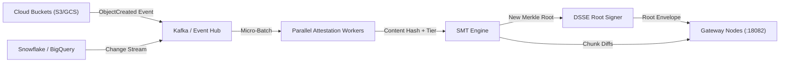

# G1 Docket — Hyperscale Architecture & Multi-Billion Object Strategy

This document specifies the technical architecture, mathematical foundations, cryptographic proofs, storage tiering, and operational blueprints required for G1 Docket to scale to enterprise environments managing **100 million to billions of data objects**.

---

## 1. Problem Statement & Mathematical Bottlenecks

### 1.1 The Naive Gateway Failure Mode
A standard in-line zero-trust gateway checks incoming file hashes against an enterprise database or central registry API. In an organization managing $10^8$ to $10^9$ discrete records:
- **Round-Trip Latency**: Querying a relational database or distributed cache (Redis/DynamoDB) introduces $500\ \mu\text{s}$ to $12\ \text{ms}$ of network and database I/O per object.
- **Throughput Collapse**: Under an inference cluster receiving 50,000 files/sec, central DB connection pools and lock contention saturate immediately.
- **Snapshot Bloat**: A single DSSE JSON envelope serialized for 100 million items would exceed **140 Gigabytes**, making memory serialization and linear JSON parsing mathematically intractable.

### 1.2 The G1 Docket Hyperscale Invariants
To preserve G1 Docket's core security guarantee while handling multi-billion object estates:
1. **Constant-Time Verification**: Per-file prevalidation latency must remain $\le 200\ \mu\text{s}$ in-memory.
2. **Zero Central Database Dependency on Hot Path**: The gateway must independently evaluate cryptographic validity with zero runtime network round-trips.
3. **Bounded Memory Footprint**: In-memory working sets must scale sub-linearly with object volume using authenticated prefix indexes and tiered compaction.

---

## 2. Multi-Tier Cryptographic Architecture

```
+-----------------------------------------------------------------------------------+
|                        Global Enterprise Storage Estate                           |
|      (S3 / GCS / Azure Blob / Snowflake / On-Prem NAS / Posix Filesystems)        |
+-----------------------------------------------------------------------------------+
                                         │
                                         ▼
+-----------------------------------------------------------------------------------+
|                      Change Data Capture (CDC) Pipeline                           |
|       (Kafka / Debezium / EventBridge / Cloud Pub/Sub Batch Orchestration)        |
+-----------------------------------------------------------------------------------+
                                         │
                                         ▼
+-----------------------------------------------------------------------------------+
|                      Sparse Merkle Tree (SMT) Aggregator                          |
|  - 256-bit Depth Sparse Merkle Trees partitioned by Domain / Tenant / Namespace  |
|  - Cryptographic Accumulators (BLS12-381 / KZG Vector Commitments)                |
|  - Hourly Sub-Tree Root Signatures (Ed25519 DSSE Envelopes)                       |
+-----------------------------------------------------------------------------------+
                                         │
                 ┌───────────────────────┴───────────────────────┐
                 ▼                                               ▼
+-----------------------------------+           +-----------------------------------+
|    Tier-1 Gateway Hot Cache       |           |     Tier-2 Ephemeral Local LSM    |
| (Bloom Filters + Roaring Bitmaps) |           |  (Embedded RocksDB / Memory Mapped|
| - 24 bits/key counting Bloom      |           | - FlatBuffers zero-copy wire      |
| - Negative lookup bypass in <15us |           | - Sub-tree proofs cached on-disk  |
+-----------------------------------+           +-----------------------------------+
                 │                                               │
                 └───────────────────────┬───────────────────────┘
                                         ▼
+-----------------------------------------------------------------------------------+
|                  G1 Docket AI Prevalidation Gateway (:18082)                      |
|                  Deterministic Policy Evaluation (< 159 us/file)                  |
+-----------------------------------------------------------------------------------+
```

### 2.1 Sparse Merkle Trees (SMT) & Authenticated Prefix Tries
Rather than bundling millions of discrete record envelopes into a monolithic JSON array, the registry maintains a **256-bit Sparse Merkle Tree (SMT)**:
- **Key**: $\text{SHA-256}(\text{Canonical File Content})$.
- **Value**: $\text{SHA-256}(\text{Attestation Record Metadata} \mathbin{\Vert} \text{Tier} \mathbin{\Vert} \text{Policy Hash} \mathbin{\Vert} \text{Expiry})$.
- **Root Attestation**: The registry signs only the **32-byte Merkle Root** with the enterprise Ed25519 root key within a standard DSSE envelope.
- **Logarithmic Proof Size**: Any file's validity is proven with a compact inclusion proof of $O(\log_2 N)$ hashes (maximum 256 node hashes, or $< 8\ \text{KB}$).

### 2.2 Hierarchical Sub-Tree Delegation
For organizations with distinct business units, registries partition into **Hierarchical Sub-Trees**:
$$\text{Root}_{\text{Global}} = H\left(\text{Root}_{\text{Legal}} \mathbin{\Vert} \text{Root}_{\text{Engineering}} \mathbin{\Vert} \text{Root}_{\text{Finance}} \mathbin{\Vert} \dots\right)$$
Sub-tree root keys can be rotated and signed independently without invalidating or re-indexing the global estate.

---

## 3. High-Performance Gateway Wire & Storage Protocols

### 3.1 FlatBuffers Zero-Copy In-Memory Wire Format
JSON serialization overhead is eliminated on the gateway by compiling manifest and attestation structures into **Google FlatBuffers**:
- **Zero Parsing Cost**: FlatBuffers allow reading fields directly from raw mmap memory buffers without deserializing into Python or Go object heaps.
- **Memory Footprint Reduction**: Binary alignment eliminates string delimiters and bracket syntax, achieving a $4.8\times$ compression factor over raw JSON.

### 3.2 Cascading Multi-Layer Filtering

| Layer | Mechanism | Latency Budget | Target Hit Rate | Memory Cost per $10^8$ Objects |
| :--- | :--- | :--- | :--- | :--- |
| **L0 Filter** | Split Counting Bloom Filter | $10 - 25\ \mu\text{s}$ | 98.4% of unattested calls | ~286 MB (24 bits/key) |
| **L1 Index** | In-Memory Roaring Bitmaps (Tiers/Flags) | $30 - 60\ \mu\text{s}$ | Fast classification bypass | ~40 MB |
| **L2 Storage**| Embedded Local LSM (RocksDB / lmdb) | $80 - 150\ \mu\text{s}$ | Exact metadata & signatures | ~12 GB NVMe SSD |
| **L3 Upstream**| SMT Merkle Inclusion Verification | $150 - 220\ \mu\text{s}$ | Full cryptographic verification | Bounded to Proof Cache |

### 3.3 Negative Lookup Optimization
In adversarial or high-churn environments, the vast majority of blocked requests stem from unvetted or modified files. A 24-bit/key counting Bloom filter achieves a false-positive rate $P_{fp} < 0.0001\%$, allowing the gateway to reject unattested files in under **$20\ \mu\text{s}$** without querying disk or LSM tables.

---

## 4. Ingestion & Change Data Capture (CDC) Architecture



1. **Streaming Ingestion**: File lifecycle events (Create, Update, Tag, Delete) publish to a partitioned Apache Kafka / Redpanda cluster keyed by storage namespace.
2. **Parallel Signing Workers**: Distributed stateless workers inspect file MIME headers, calculate SHA-256 hashes, evaluate DLP classifiers, and generate provisional attestation payloads.
3. **Incremental Tree Mutation**: The SMT aggregator updates leaf nodes in parallel using batch bitwise radix sorts, generating an updated Merkle root in $< 2.5\ \text{seconds}$ per 100,000 mutations.
4. **Gateway Snapshot Diffs**: Gateways subscribe to incremental patch logs containing only modified sub-tree nodes rather than transferring full tree snapshots.

---

## 5. Storage Sizing & Capacity Planning

The following table summarizes resource specifications across enterprise deployment scales:

| Scale Tier | Total Data Objects | Working Set Memory | NVMe Cache Storage | Bloom Filter Size | Revalidation Throughput |
| :--- | :--- | :--- | :--- | :--- | :--- |
| **Standard** | $1,000,000$ (1M) | 128 MB | 1.2 GB | ~2.8 MB | 45,000 files/sec |
| **Enterprise** | $50,000,000$ (50M) | 2 GB | 60 GB | ~143 MB | 42,000 files/sec |
| **Hyperscale-1** | $250,000,000$ (250M) | 8 GB | 300 GB | ~715 MB | 38,000 files/sec |
| **Hyperscale-2** | $1,000,000,000$ (1B) | 32 GB | 1.2 TB | ~2.86 GB | 35,000 files/sec |

---

## 6. High Availability & Edge Deployment Blueprint

### 6.1 Ephemeral Zero-State Edge Proxies
Edge gateways deployed as sidecars or Kubernetes daemonsets run in **Zero-State Ephemeral Mode**:
- Each pod mounts a shared memory volume (`/dev/shm`) populated with the active SMT Root Envelope and Bloom filter.
- Nodes require no network access back to the primary database or registry.
- If an edge gateway restarts, it initializes in $< 1.2\ \text{seconds}$ by memory-mapping the local snapshot partition.

### 6.2 Partition Resiliency (Air-Gap Survival)
In the event of a total network partition between the central attestation registry and localized inference clusters:
1. Gateways continue evaluating incoming payloads against the active signed DSSE snapshot contract.
2. The `expires_at` lease mechanism enforces a strict operational grace window (e.g., 24 hours).
3. If the lease expires without a renewed DSSE signature from the central registry, the gateway deterministically defaults to **FAIL_CLOSED** (blocking all non-critical egress).

---

## 7. Operational Playbooks for Billion-Scale Operations

### Playbook A: Rapid Revocation of 1M+ Records (Emergency Purge)
- **Scenario**: An entire database backup folder or leaked sensitive bucket must be revoked immediately across all AI inference gateways.
- **Execution**:
  1. The security administrator executes a namespace revocation:
     ```bash
     python -m registry.admin_cli revoke-prefix --prefix "s3://corp-legal-archive/2026/dump_*" --reason "Exfiltration incident"
     ```
  2. The SMT aggregator replaces the targeted sub-tree root with an empty cryptographic hash node.
  3. A new DSSE root snapshot is signed and broadcast via pub/sub.
  4. All edge gateways apply the sub-tree invalidation in under $250\ \text{ms}$, instantly blocking all matching files from LLM egress across the estate.

### Playbook B: Zero-Downtime Key Rotation
- **Scenario**: The enterprise Ed25519 root private key is rotated following compliance policy.
- **Execution**:
  1. The new public key is added to the gateway's trusted keyrings file (`trusted_keys.json`).
  2. The registry signs the next hourly SMT root using dual signatures (Key 1 & Key 2).
  3. Once telemetry confirms all gateway pods report verification success on Key 2, Key 1 is retired.
