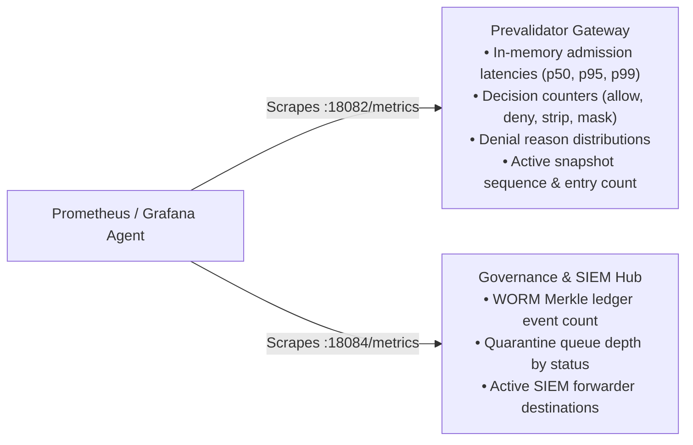

# G1 Docket — Observability, Telemetry & Monitoring Architecture

This specification documents the institutional telemetry architecture, Prometheus metrics exposition endpoints, Kubernetes monitoring CRDs, and Grafana dashboard integration for **G1 Docket**.

---

## 1. Observability Architecture Overview

G1 Docket exposes native Prometheus text exposition metrics (`text/plain; version=0.0.4; charset=utf-8`) across its two primary operational endpoints without third-party agents or external sidecars:



---

## 2. Exported Metric Catalogs

### A. Prevalidator Admission Gateway (`http://<host>:18082/metrics`)

| Metric Name | Type | Description | Labels |
| :--- | :--- | :--- | :--- |
| `g1_docket_mode` | Gauge | Current gateway operational posture (1 = active) | `mode="enforce"` or `mode="observe"` |
| `g1_docket_evaluations_total` | Counter | Total admission decisions evaluated | `mode="enforce"` or `mode="observe"` |
| `g1_docket_evaluations_by_decision_total` | Counter | Total evaluations partitioned by outcome | `decision="allow"`, `"deny"`, `"strip"`, `"mask"` |
| `g1_docket_policy_denials_by_reason_total` | Counter | Total policy rejections by reason code | `reason="UNATTESTED"`, `"INSUFFICIENT_CLEARANCE"`, `"EGRESS_DENIED"`, `"HASH_DRIFT"`, `"EXPIRED"`, `"REVOKED"` |
| `g1_docket_evaluation_duration_seconds` | Summary | Sub-millisecond evaluation latency quantiles and sum | `quantile="0.5"`, `"0.95"`, `"0.99"` |
| `g1_docket_active_snapshot_sequence` | Gauge | Monotonic sequence number of the active signed DSSE snapshot | None |
| `g1_docket_active_snapshot_entries` | Gauge | Total active attested records currently loaded in-memory | None |

### B. HITL Governance & SIEM Hub (`http://<host>:18084/metrics`)

| Metric Name | Type | Description | Labels |
| :--- | :--- | :--- | :--- |
| `g1_docket_governance_worm_events_total` | Counter | Monotonically increasing count of verified events in the append-only WORM Merkle ledger | None |
| `g1_docket_governance_quarantine_items` | Gauge | Quarantined data objects partitioned by review lifecycle state | `status="QUARANTINED"`, `"AWAITING_SECOND_KEY"`, `"RELEASED"`, `"REJECTED"` |
| `g1_docket_governance_siem_destinations` | Gauge | Configured SIEM forwarding destinations by operational status | `enabled="true"` or `enabled="false"` |

---

## 3. Prometheus Scrape Configuration

### Vanilla Prometheus (`prometheus.yml`)

```yaml
scrape_configs:
  - job_name: "g1-docket-prevalidator"
    metrics_path: "/metrics"
    static_configs:
      - targets: ["docket-prevalidator:18082"]

  - job_name: "g1-docket-governance"
    metrics_path: "/metrics"
    static_configs:
      - targets: ["docket-governance:18084"]
```

### Prometheus Operator (`ServiceMonitor`)

When deploying via the [G1 Docket Helm Chart](deploy/helm/g1-docket/README.md), enable the native `ServiceMonitor`:

```yaml
# values.yaml
monitoring:
  serviceMonitor:
    enabled: true
    interval: "15s"
    scrapeTimeout: "10s"
    labels:
      release: prometheus-stack
```

---

## 4. Institutional Alerting Rules (`PrometheusRule`)

The Helm chart includes pre-configured alerting thresholds under [`deploy/helm/g1-docket/templates/prometheusrule.yaml`](deploy/helm/g1-docket/templates/prometheusrule.yaml):

1. **`G1DocketHighPolicyDenialRate` (Warning)**:
   - **Condition**: Denial rate $> 15\%$ over 5 minutes.
   - **Significance**: Indicates potential data exfiltration probing, untagged data injection, or invalid client credentials.
2. **`G1DocketSubMillisecondSLABreached` (Critical)**:
   - **Condition**: p95 evaluation duration $> 5\text{ ms}$ over 1 minute.
   - **Significance**: Breaches the $< 1\text{ ms}$ sub-millisecond in-memory zero-DB SLA budget.
3. **`G1DocketActiveSnapshotExpiringSoon` (Critical)**:
   - **Condition**: Active snapshot sequence number is 0 or snapshot has expired.
   - **Significance**: Gateway will fail closed and deny all inbound requests until a fresh signed snapshot is published.
4. **`G1DocketQuarantineBacklog` (Warning)**:
   - **Condition**: More than 50 quarantined records pending review for $> 15\text{ minutes}$.
   - **Significance**: Requires operator attention in the Four-Eyes Dual-Key governance triage interface.

---

## 5. Grafana Dashboard Integration

G1 Docket ships with a production-grade, pre-built dashboard model under [`deploy/grafana/g1-docket-dashboard.json`](deploy/grafana/g1-docket-dashboard.json).

### Automatic Provisioning via Helm Sidecar
The Helm chart provides an auto-provisioning ConfigMap tagged with `grafana_dashboard: "1"`:

```yaml
# values.yaml
monitoring:
  grafanaDashboard:
    enabled: true
    labels:
      grafana_dashboard: "1"
```

### Dashboard Panels
- **Row 1: Key Executive Metrics**: Total Evaluations, Gateway Posture (ENFORCE vs. OBSERVE), Active Snapshot Sequence, WORM Ledger Height, Active Quarantine Count.
- **Row 2: Latency & Throughput**: Sub-Millisecond Latency Quantiles (p50, p95, p99) vs 5ms SLA line, and Admission Rate (req/sec) stacked by decision (`allow`, `deny`, `strip`, `mask`).
- **Row 3: Policy Denials & Governance**: Donut chart of denial reason codes (`UNATTESTED`, `INSUFFICIENT_CLEARANCE`, `EGRESS_DENIED`, `HASH_DRIFT`) and Quarantine Incidents by lifecycle state.

---

## 6. Real-Time Telemetry via Python SDK

Developers can inspect live latency metrics directly via the [`DocketClient`](docs/sdk.md):

```python
from docket import DocketClient

with DocketClient(base_url="http://localhost:18082") as client:
    health = client.get_health()
    latency = health.get("latency", {})
    print(f"p50: {latency.get('p50_ms')} ms | p95: {latency.get('p95_ms')} ms | SLA: {latency.get('sla_compliant_pct')}%")
```
