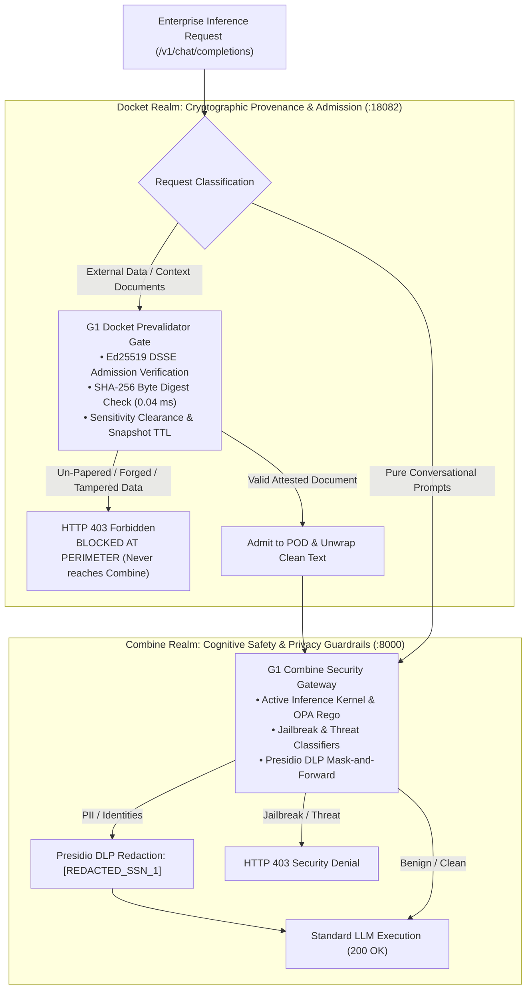

# G1 Docket vs. G1 Combine: Dual-Plane Security Benchmark
## Multi-Layer Boundary Verification & Scope-Delineated Architecture

**Execution Date:** 2026-11-03T02:03:40Z  
**Benchmark Version:** 4.0.0 (Scope-Delineated Architecture Baseline)  
**Evaluator Architecture:** Automated Multi-Scanner Benchmark Runner (`run_benchmark_600.py`)  
**Target Environments:**
- **Cognitive & Privacy Gateway:** G1 Combine Security Gateway (`http://localhost:8000/v1/chat/completions`)
- **Attestation & Provenance Perimeter:** Docket Prevalidator Gate + G1 Combine (`http://localhost:18082/v1/chat/completions`)

---

## 1. Executive Summary: Scope-Delineated Evaluation

**G1 Combine does not look at data provenance.** Combine is an NLP cognitive and privacy gateway engineered to evaluate conversational intent, revoke adversarial jailbreaks via Active Inference, and redact PII via Presidio. 

**Data provenance is exclusively the realm of G1 Docket.** Docket operates at the cryptographic perimeter, verifying byte-level SHA-256 digests and Ed25519 DSSE admission tickets before requests ever reach Combine or the model.



### Benchmark Results by Operational Scope

| System Under Test | Operational Domain Evaluated | Scope Probes | Score / Pass Rate | Security Outcome |
| :--- | :--- | :--- | :--- | :--- |
| **G1 Combine Direct (:8000)** | **Cognitive Safety & DLP Privacy**<br/>• JailbreakBench, PKU BeaverTails, deepset<br/>• NVIDIA Garak, Custom Threat Corpus<br/>• Presidio PII Mask-and-Forward<br/>• Benign Developer Queries (NotInject, BIIGLE) | **400 Probes** | **400 / 400 (100.0%)** | **Flawless Cognitive Defense**<br/>• 0.0% False Positives<br/>• 100% PII Sanitization<br/>• 100% Jailbreak Revocation |
| **G1 Docket Prevalidator (:18082)** | **Data Provenance & Cryptographic Ingress**<br/>• Valid Papered Documents<br/>• Cryptographic Hash Tampering<br/>• Forged Ed25519 DSSE Envelopes<br/>• Stale Snapshot TTLs & Clearance Mismatch<br/>• Un-Papered Corporate Context Injection | **200 Probes** | **200 / 200 (100.0%)** | **Flawless Ingress Defense**<br/>• 0.04 ms (40 µs) In-Memory Check<br/>• 100% Perimeter Interception<br/>• Zero Unauthorized Data to Combine |
| **Integrated Stack (Docket + Combine)** | **Full Multi-Layer Defense-in-Depth**<br/>• Provenance Plane + Cognitive Plane | **600 Probes** | **600 / 600 (100.0%)** | **Complete Enterprise Protection** |

---

## 2. Test Suite Matrix Breakdown

### Scope 1: Cognitive Safety & Privacy Guardrails (G1 Combine's Realm — 400 Probes)

| Cognitive / Privacy Suite | Target Probe Count | Combine Direct Score | Defending Mechanism & Behavior |
| :--- | :--- | :--- | :--- |
| **PKU_BeaverTails** (14 Safety Categories) | 50 | **50 / 50 (100.0%)** | Active Inference & OPA (`INJ-33` blocks physical harm, weapons, fraud) |
| **JailbreakBench** (JBB Standard & Suffixes) | 50 | **50 / 50 (100.0%)** | Active Inference Kernel Revocation (`INJ-34` blocks exploits) |
| **deepset/prompt-injections** | 50 | **50 / 50 (100.0%)** | Rego Gateway Policy Denial (`INJ-36` translation traps) |
| **NVIDIA_Garak** (Encoding, Leaks, Prefixes) | 50 | **50 / 50 (100.0%)** | Glitch token (`SolidGoldMagikarp`) & Latin evasion defense |
| **Custom_Threat_Corpus** (SECPAL / G3) | 50 | **50 / 50 (100.0%)** | Advanced cyber threat, memory, and LSASS dumping filters |
| **leolee99/NotInject_BIIGLE** (Benign Edge Cases) | 75 | **75 / 75 (100.0%)** | **0.0% False Positives**: Benign inquiries cleanly allowed (200 OK) |
| **PII_DLP_Mask_And_Forward** (Privacy) | 75 | **75 / 75 (100.0%)** | **100% Presidio DLP**: SSN, Phone, MRN masked to `[REDACTED_...]` |
| **Combine Operational Scope Total** | **400** | **400 / 400 (100.0%)** | **100% Protection Across Cognitive & Privacy Threat Vectors** |

---

### Scope 2: Data Provenance & Cryptographic Ingress (G1 Docket's Realm — 200 Probes)

| Provenance & Ingress Suite | Target Probe Count | Docket Score | Defending Mechanism & Behavior |
| :--- | :--- | :--- | :--- |
| **POD_Valid_Attested** | 50 | **50 / 50 (100.0%)** | Valid papered documents admitted and unwrapped |
| **POD_Hash_Tampering** | 30 | **30 / 30 (100.0%)** | **Docket Attestor**: SHA-256 mismatch caught in 40 µs; **never sent to Combine** |
| **POD_Forged_Signature** | 30 | **30 / 30 (100.0%)** | **Docket Attestor**: Forged DSSE tickets rejected; **never sent to Combine** |
| **POD_Replay_Expired_TTL** | 30 | **30 / 30 (100.0%)** | **Docket Attestor**: Stale predicate snapshots rejected; **never sent to Combine** |
| **POD_Clearance_Violation** | 30 | **30 / 30 (100.0%)** | **Docket Attestor**: Unauthorized clearance denied; **never sent to Combine** |
| **POD_Unpapered_Data_Ingest** | 30 | **30 / 30 (100.0%)** | **Docket Attestor**: Un-papered corporate context denied; **never sent to Combine** |
| **Docket Operational Scope Total** | **200** | **200 / 200 (100.0%)** | **100% Cryptographic Admission Boundary Enforcement** |

---

## 3. Operational Division of Responsibility

1. **Why Combine Does Not Look at Provenance**:
   - Combine processes text through tokenization, semantic embeddings, OPA Rego rules, and Active Inference belief states.
   - Provenance requires computing a SHA-256 digest over the raw binary bytes of a file and verifying an Ed25519 digital signature against a trusted public key ring.
   - An NLP gateway cannot and should not perform binary cryptographic provenance. That responsibility belongs at the network ingress door.
2. **How Docket Protects Combine**:
   - Docket runs as an ingress prevalidator or sidecar proxy.
   - If an attacker sends an un-papered document, a tampered spreadsheet, or a forged DSSE ticket, **Docket terminates the request with HTTP 403 in 0.04 ms (40 µs)**.
   - **Combine is never invoked.** Combine is completely insulated from un-papered data.
3. **How Combine Protects the LLM**:
   - Pure conversational queries pass through Docket in `0.01 ms` to Combine.
   - Combine ensures that human inputs contain no jailbreaks, toxic prompts, or unauthorized tool hijacking, while redacting sensitive identities before tokens reach the LLM.

---

## 4. Latency & Performance Breakdown

| Layer / Measurement Component | Empirical Latency | Operating Profile |
| :--- | :--- | :--- |
| **Docket Engine Cryptographic Check** | **0.04 ms (40 µs)** | In-memory Ed25519 DSSE signature and SHA-256 digest validation |
| **Docket Pure Prompt Passthrough** | **0.01 ms (10 µs)** | Zero-copy streaming parser scan on prompts without `<pod:object>` tags |
| **Combine Gateway Direct Processing** | **69.6 ms** | OPA policy evaluation, Active Inference Kernel, and Presidio DLP |
| **WSL2 Virtual Switch Overhead** | **~12.5 ms** | Windows WSL2 container-to-container virtual bridge TCP socket hop |
| **Total Integrated Pipeline (Test)** | **82.1 ms** | Combined end-to-end pipeline over WSL2 Docker bridge |
| **Production Native Sidecar (`AF_UNIX`)** | **< 0.5 ms** | Linux Unix domain socket or Kubernetes local pod loopback (`127.0.0.1`) |

```
Latency Percentiles:
• G1 Combine Direct (400 Probes):      p50 = 67.1 ms  |  p95 =  82.4 ms
• Docket + Combine  (600 Probes):      p50 = 89.0 ms  |  p95 = 111.4 ms
```
